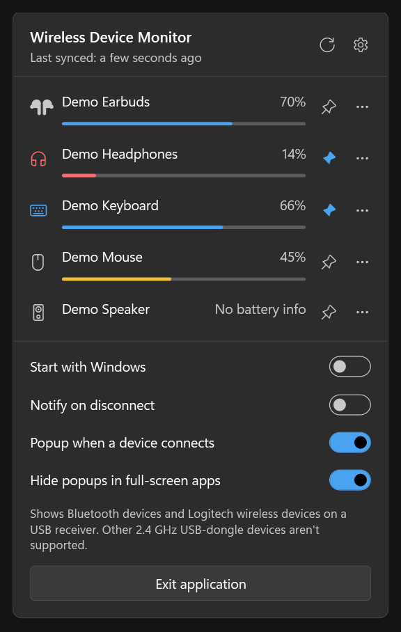
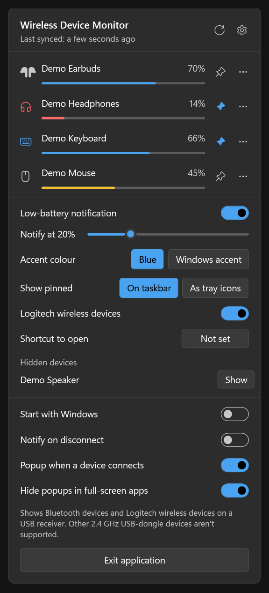
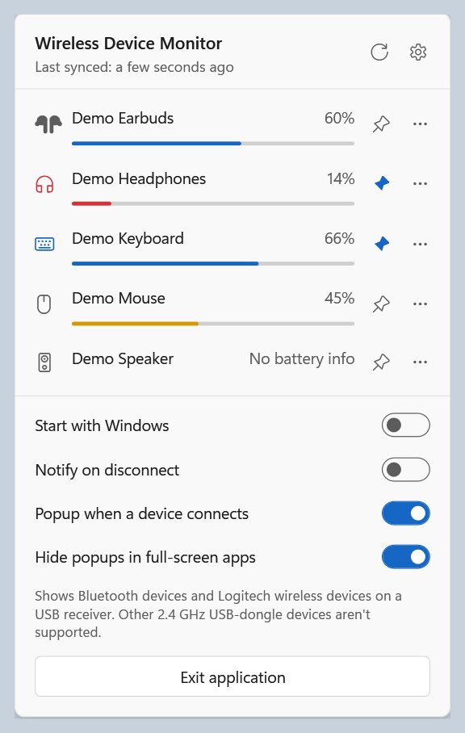
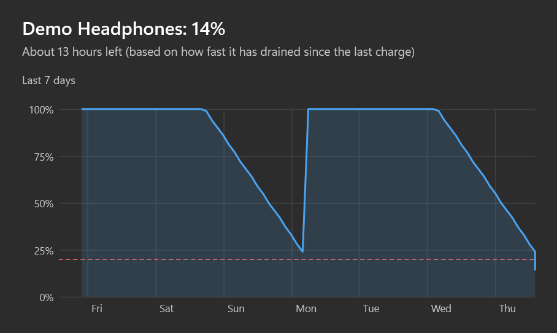
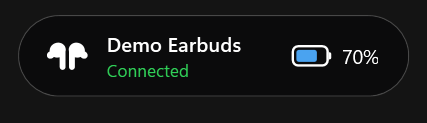
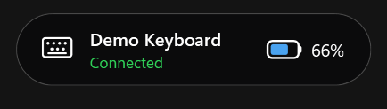
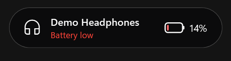
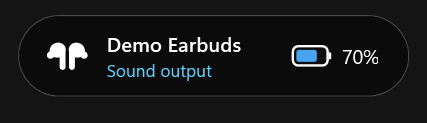
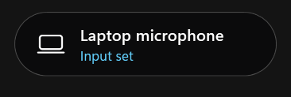

# BT Battery Indicator

A small, free Windows 10 (1809+) / Windows 11 tray app that shows the battery level of your paired Bluetooth devices.
Everything stays on your PC: no account, no ads, no telemetry, no network access.

- Battery % for Bluetooth mice, keyboards, headphones, earbuds, controllers and phones
- Left, right and case levels for AirPods and Beats earbuds, read from the battery signal they broadcast
- Battery level for Logitech wireless mice and keyboards on a Lightspeed, Unifying or Bolt USB receiver
- Pin devices to show them in a strip on the taskbar with a battery gauge and percentage, or as numbered tray icons if you prefer (yellow under 50%, red under 20%)
- Hover any tray icon to see every connected device
- Low-battery warning at a level you choose (10–50%), shown as a small popup that drops down from the top of the screen
- The same popup when a Bluetooth device connects, showing its battery (can be switched off); popups can stay out of the way of full-screen apps
- An optional notification when a pinned device disconnects
- Click a connected Bluetooth audio device on the taskbar strip to move the sound to it
- A popup whenever Windows' sound output or microphone changes, however it was changed
- Connect or disconnect Bluetooth headphones, earbuds and speakers from the device menu (they stay paired)
- 7-day battery history chart with a time-left estimate
- Rename or hide devices; light and dark theme; optional start with Windows

Other devices that connect through a 2.4 GHz USB dongle are not supported, and a device that does not report a level
shows "No battery info".

## Screenshots

All screenshots use made-up demo devices.

| Device list | Settings |
| --- | --- |
|  |  |

| Light theme | Battery history |
| --- | --- |
|  |  |

Pinned devices on the taskbar (dark and light taskbar, and earbuds with one bud charging in its case):


Popup when a device connects:




Low battery, and a change of sound output or microphone (shown however it was changed):






## Install (one command)

Get `BTBatteryIndicator-win-x64.zip` (from this repository's Releases page if one is published, or build it as shown
below). Unzip it, click the File Explorer address bar in that folder, type `powershell`, press Enter, then run:

```powershell
powershell -ExecutionPolicy Bypass -File install.ps1
```

It installs for your user only (no administrator prompt), adds Start Menu and desktop shortcuts, and starts the app.
After that, start it any time from the Start Menu (type "BT Battery") or the desktop shortcut. Windows 11 hides new tray icons under
the `^` arrow near the clock; drag the icon out to keep it visible.

The app is not code-signed, so Windows SmartScreen may show "Windows protected your PC" the first time.
That warning means "unknown publisher", not "malware found". Choose **More info > Run anyway** only if you trust where
you got the zip.

Uninstall: `powershell -ExecutionPolicy Bypass -File install.ps1 -Uninstall` (add `-RemoveData` to delete settings and history).

## Use

- **Left-click** the tray icon: open the panel. **Right-click**: refresh or exit.
- **Pin** button on a row: that device appears on the taskbar and moves with it when the taskbar auto-hides.
- **Click a pinned device that is not connected** (on the taskbar strip): asks Windows to connect it. Works for headphones, earbuds and speakers.
- **Click a connected headphone, earbud or speaker** on the strip: Windows plays sound through it, instead of the PC speakers or whatever was playing before. If it is already playing, the click opens the panel.
- **Click a row** or the **…** button: battery history, rename, hide.
- **Gear** button: low-battery notification level, accent colour, taskbar strip or tray icons, Logitech reading, a keyboard shortcut to open the panel, hidden devices.

## Build from source (one command)

Needs the .NET 10 SDK (`winget install Microsoft.DotNet.SDK.10`). Then, in the project folder:

```powershell
.\build.ps1 package
```

This produces `dist\BTBatteryIndicator-win-x64.zip`, and if the app is already installed on that PC it updates and restarts
the installed copy. `.\build.ps1 install` builds and installs in one go. `.\build.ps1` on its own builds and runs the automated tests;
`.\build.ps1 demo` starts the app with made-up devices so you can try everything without real hardware.

## How it works

The app reads the battery value Windows already keeps for each paired Bluetooth device (the same number shown in
Windows Settings). By itself it only reads: it never pairs or unpairs a device, and never connects, disconnects or
changes one unprompted. Three things happen only when you click: connecting a paired audio device, disconnecting one,
and choosing which device Windows plays sound through. Windows has no published call for choosing the sound output,
so the app uses the unpublished one that Windows' own sound panel uses. Apple earbuds are the exception to
"Windows already has it": they broadcast their levels instead, so while they are connected the app listens for that
broadcast for a few seconds at a time. Listening is receive-only.

Logitech receiver devices are the one case where the app sends anything: every two minutes it asks the device for its
battery level using Logitech's own message format. It never changes a device setting, and the gear panel has a switch
to turn this off. Settings and history are plain JSON files in `%LOCALAPPDATA%\BTBatteryIndicator`.

The app contains no network code and uses no third-party packages: only .NET and Windows' own interfaces.

## Project layout

| Path | What is there |
| --- | --- |
| `src/Core` | Reading devices, settings, history and alerts. No user interface. |
| `src/App` | The tray app: panel, taskbar strip, popups, tray icons. |
| `tests` | Automated checks, run by `.\build.ps1`. No test framework needed. |
| `tools` | Scripts that measure resource use and how closely the strip follows the taskbar. |
| `docs/SPEC.md` | Requirements, each with its pass/fail check and current status. |
| `docs/DECISIONS.md` | Design decisions, one line each, with the reason. |
| `docs/DOWNLOADS.md` | Everything the build downloads: source, version, licence, checksum. |
| `build.ps1`, `install.ps1` | Build, test, package and install. |

`BTBatteryIndicator.slnx` opens all three projects in Visual Studio or Rider.

## License

MIT. See `LICENSE`.
